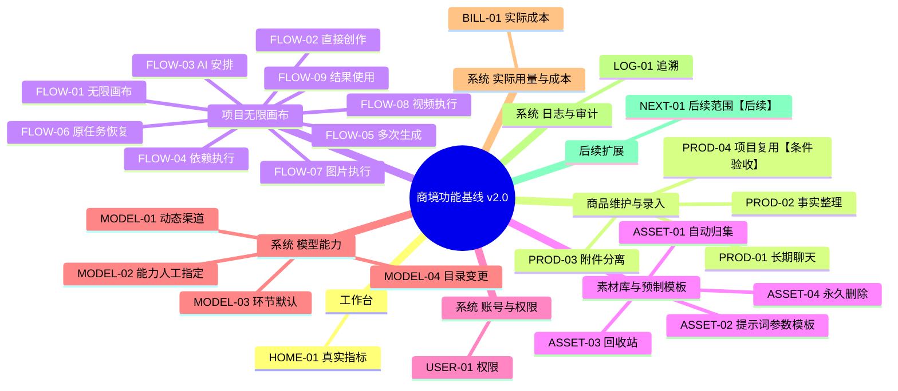

# 商境功能思维导图 v2.0

与 [开发基线](FUNCTIONAL_SPEC.md) 同源生成。下列“本轮”表示需求范围，不表示功能已经开发。

[交互版](ecommerce-ai-feature-mindmap.html) · [SVG 完整图](ecommerce-ai-feature-mindmap.svg)

## 功能树

### 工作台

- **HOME-01 真实指标**（本轮）：商品、项目、任务、素材与实际成本来自真实接口，空值不冒充零，无旧报价待办。

### 商品维护与录入

- **PROD-01 长期聊天**（本轮）：首消息建未命名商品，文字和图片、多轮持久化；失败保留输入。
- **PROD-02 事实整理**（本轮）：明确事实自动入库，冲突追问，不推测事实；资料可编辑，保护手工字段。
- **PROD-03 附件分离**（本轮）：资料仅识别；素材独立上传；显式转为商品素材才可生成。
- **PROD-04 项目复用**（条件验收）：创建即进画布；资料更新由用户同步到未开始任务。

### 项目无限画布

- **FLOW-01 无限画布**（本轮）：React Flow 主界面，平移缩放、节点拖动、兼容连线/DAG、参数与布局持久化。
- **FLOW-02 直接创作**（本轮）：默认一个带商品资料的生图任务，取消报价和强制六步。
- **FLOW-03 AI 安排**（本轮）：新增/建议修改未开始任务，预览确认；默认只图片，视频显式要求。
- **FLOW-04 依赖执行**（本轮）：手动开始并列范围，复用成功前置；缺具体上游版本则暂停待选，再次开始。
- **FLOW-05 多次生成**（本轮）：同任务多版本，冻结输入/模型/商品事实；下游手选具体成功结果。
- **FLOW-06 原任务恢复**（本轮）：未知只核实原请求不重生，不换模型；明确失败手动重试；继续未完成复用成功。
- **FLOW-07 图片执行**（本轮）：OMYAI/OpenAI 兼容生成与改图，服务端读取创作素材；商品外观需素材，背景概念可文字。
- **FLOW-08 视频执行**（本轮）：MiniMax H3 文生/单图首帧；提交、进度、取消、转存、预览下载。
- **FLOW-09 结果使用**（本轮）：成功立即下载、继续修改；精修/打包按需，无强制审核。

### 素材库与预制模板

- **ASSET-01 自动归集**（本轮）：全部成功图/视频进素材库，附商品/项目/任务/版本。
- **ASSET-02 提示词参数模板**（本轮）：图/视频持久化 CRUD，下拉快速选择，预览确认；保留图片选择与套用快照。
- **ASSET-03 回收站**（本轮）：商品/项目/素材移入、查看、恢复；运行中项目阻止；无自动清理。
- **ASSET-04 永久删除**（本轮）：管理员手动，先预览；商品/素材被项目引用时阻止，含回收站项目；项目连同生成结果清理，他项目引用则阻止。

### 系统 · 账号与权限

- **USER-01 权限**（本轮）：管理员全权，运营业务写/模板/移入恢复，查看者只读；永久删除/模型配置仅管理员。

### 系统 · 模型能力

- **MODEL-01 动态渠道**（本轮）：OpenAI/Anthropic 目录同步、手工 ID、加密 Key；失败保留配置。
- **MODEL-02 能力人工指定**（本轮）：文本/读图理解/生图/视频多选，人工启用；实际执行器能力分开显示。
- **MODEL-03 环节默认**（本轮）：商品聊天识别、AI 规划、生图、视频分别默认，创作任务可切兼容模型。
- **MODEL-04 目录变更**（本轮）：新模型不自动启用，消失标不可用，保留配置历史，不自动换默认。

### 系统 · 实际用量与成本

- **BILL-01 实际成本**（本轮）：无报价/充值/余额门槛，记录用量；未知金额显示未统计而非零。

### 系统 · 日志与审计

- **LOG-01 追溯**（本轮）：模型、输入快照、来源、版本；最小成本与删除审计，日志不含 Key。

### 后续扩展

- **NEXT-01 后续范围**（后续）：PDF/Word/Excel 直接读取、多商品聊天、多 SKU、复杂视频参考、扩展工作流模板管理。

## Mermaid 源码

生成方式：`python scripts/docs/build_feature_map.py`。功能表为来源，禁止只改图而不更新功能基线。
